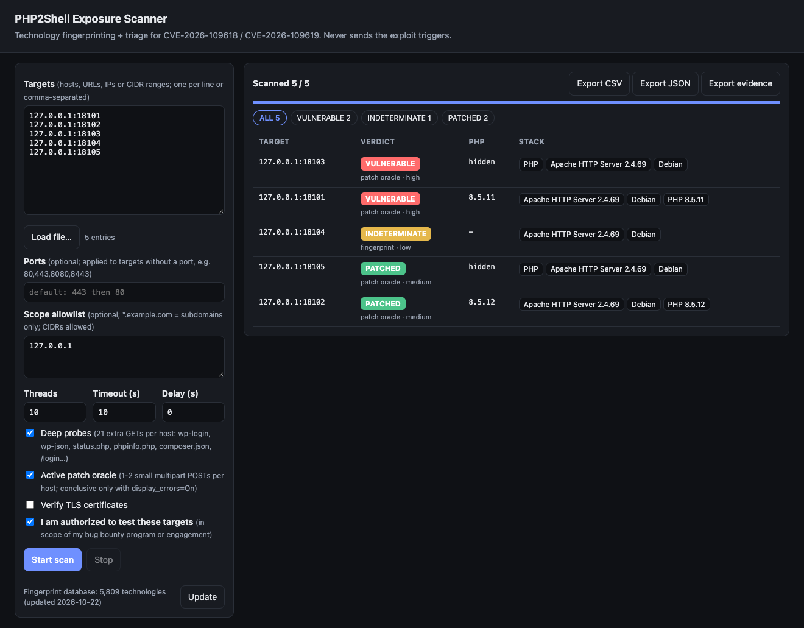
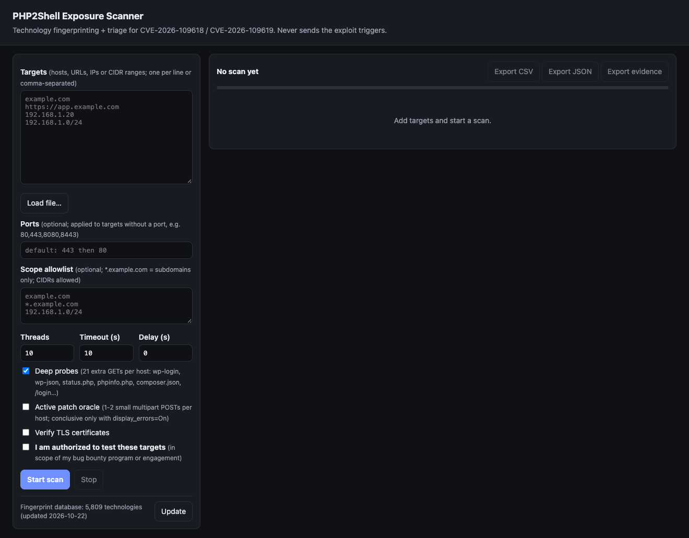
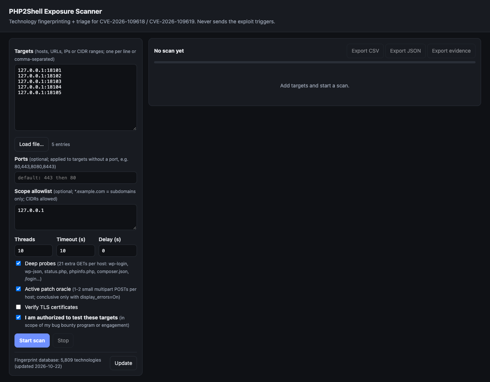
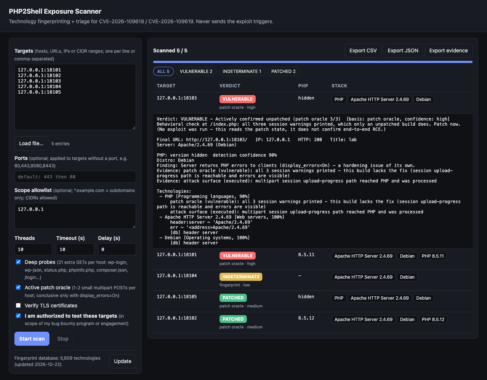

# PHP2Shell Scanner

A single-file scanner that fingerprints websites and checks whether their PHP is affected by **PHP2Shell**. PHP2Shell is a pair of critical unauthenticated RCE bugs in PHP, CVE-2026-109618 and CVE-2026-109619.

You give it a list of URLs or subdomains. For each one it works out what the site runs (web server, PHP, CMS, frameworks, CDN or WAF, and so on) and whether the PHP version is affected.

> ⚠️ **Only scan targets you are authorized to test**, for example assets that are in scope for your bug bounty program. Check the program's rules on automated scanning and rate limits before you start.



<details>
<summary><b>More screenshots</b> — the empty state, the form filled in, and a row expanded</summary>
<br>

All four are real captures against the local test lab in [`lab/`](lab/) — genuine PHP 8.5.11 (unpatched) and 8.5.12 (fixed) containers, not staged data.

| | |
|---|---|
|  |  |
| Empty state on first load | Form filled in, ready to scan |



A row expanded — this is the case where the version is completely hidden and the [active patch oracle](#evidence-for-bug-reports-and-attack-surface-context) settles it anyway: `127.0.0.1:18103` discloses no PHP version, but the behavioral check actively confirms `VULNERABLE` with high confidence.

</details>

---

## What it checks

| | |
|---|---|
| **Vulnerability** | CVE-2026-109618 and CVE-2026-109619 (CVSS v4.0 9.2), unauthenticated remote code execution in PHP core |
| **Fixed in** | PHP **8.2.35**, **8.3.36**, **8.4.27** and **8.5.12** (released 2026-10-21) |
| **Affected** | Everything from 5.4.0 up to those releases. 7.4, 8.0 and 8.1 only got source backports, not official releases. |

The scanner **never sends the exploit triggers**. Its verdicts come from the PHP version and other fingerprints. They tell you a host is exposed, not that it was exploited.

---

## Requirements

- Python **3.8 or newer** (tested on 3.10). Nothing to `pip install`; it uses only the standard library.
- Internet access the first time it runs, to download the fingerprint database (about 4 MB, cached in `~/.cache/php2shell-scanner/`). Without it the scanner still works, using its built-in signatures only.

---

## Quick start

### One-click setup

```bash
git clone https://github.com/kunshdeep2812/php2shell-scanner.git
cd php2shell-scanner
python3 setup.py
```

`setup.py` works with whatever Python you have, from 3.6 up:

- If your `python3` is already 3.8+, it uses it directly.
- If it's older, it looks for a newer `python3.X` already installed, and if none exists, offers to install one via [pyenv](https://github.com/pyenv/pyenv) (installing pyenv itself first if needed — it prompts before installing anything).
- Either way it creates an isolated virtual environment in `.venv/`, so nothing touches your system Python. (The scanner itself has zero third-party dependencies — standard library only — so there's nothing to download for it specifically; the venv just avoids the "externally-managed-environment" error newer macOS/Linux Python installs give for bare `pip install`.)
- It then prints the exact commands to run, and offers to launch the GUI immediately.

Non-interactive / CI use: `python3 setup.py --yes` (auto-installs pyenv/Python if needed, never launches the GUI) or `python3 setup.py --non-interactive --no-pyenv` (fails cleanly instead of installing anything). Add `--launch` to start the GUI right after setup.

Prefer to do it by hand? The scanner is one file with no dependencies — `python3 scanner.py` works as long as `python3` is 3.8+.

### GUI (recommended)

```bash
python3 scanner.py
```

Your browser opens at **http://127.0.0.1:8765**.

1. Paste your targets, one per line, or click **Load file…**.
2. Optionally, add your program's **scope allowlist**.
3. Tick **"I am authorized to test these targets"**.
4. Click **Start scan**.

Results stream in with the riskiest hosts first. Click any row to see the full evidence. Use **Export CSV** or **Export JSON** to save the report, or **Export evidence** for a Markdown proof-of-finding you can attach to a bug report (needs the active oracle).

### Command line

```bash
# One or more targets
python3 scanner.py --cli --authorized -t example.com -t https://app.example.com

# Target file + scope file + deep probes + reports
python3 scanner.py --cli --authorized -f targets.txt --scope scope.txt --deep \
    --csv results.csv --json results.json
```

The CLI exits with code **2** if any host is `VULNERABLE` or `LIKELY_VULNERABLE`, and **0** otherwise, so you can use it in scripts or CI.

### Offline grading (no network)

When you already know the version, or you have a saved `phpinfo()` page, you can get a verdict without sending any traffic. These modes don't need `--authorized`.

```bash
# Grade a version string (from an inventory, a login banner, etc.)
python3 scanner.py --version-string 8.3.12          # -> VULNERABLE
python3 scanner.py --version-string 8.1.2-1ubuntu2.28   # -> PATCHED (exact USN check)

# Grade a saved phpinfo() dump — also reports the mitigation settings it finds
python3 scanner.py --phpinfo ./phpinfo.html
```

A `phpinfo()` dump gives a definite answer, including the SAPI and whether `session.upload_progress.enabled`, `memory_limit` and `post_max_size` are set.

---

## Local network

### Scanning devices on your LAN

Targets can be IP addresses or CIDR ranges. Use **Ports** (`--ports`) to check web servers on non-standard ports.

```bash
# A single machine (e.g. your laptop or a dev server)
python3 scanner.py --cli --authorized -t 192.168.1.20 --ports 80,443,8080,8443

# A whole /24, limited to that range
python3 scanner.py --cli --authorized -t 192.168.1.0/24 --ports 80,443,8080 \
    --scope lan-scope.txt --csv lan.csv        # lan-scope.txt contains: 192.168.1.0/24
```

- A range expands to every host in it. The limit is 5,000 targets per scan, e.g. a /24 with 19 ports.
- Each host first gets a quick TCP check, so unused IPs fail in a few seconds and come out as `ERROR - No web server`.
- Without `--ports`, the scanner tries 443 (https) and then 80 (http).

To find your laptop's IP on macOS, run `ipconfig getifaddr en0`. On Linux, run `hostname -I`.

### Opening the GUI from other devices

```bash
python3 scanner.py --lan
```

The terminal prints two links:

```text
php2shell-scanner GUI: http://127.0.0.1:8765/?token=Xa9...  (Ctrl+C to quit)
Local network link:    http://192.168.1.101:8765/?token=Xa9...
```

Open the **Local network link** on any phone or computer on the same Wi-Fi.

- **Access is token-protected.** A new random token is created each time the scanner starts. Without it, the page returns *401 Access token needed*. The token is moved into a browser cookie after the first visit.
- **Anyone with the link can run scans from your machine.** Only share it with people you trust, and stop the scanner (Ctrl+C) when you're done.
- **Firewall prompt.** On macOS you may be asked to allow incoming connections for Python. Click *Allow*.
- **Bind address.** `--host 192.168.1.101` binds to one specific interface instead of all of them.

---

## Input formats

**targets.txt**: one target per line. You can also separate them with commas. Lines starting with `#` are ignored.

```text
# main assets
example.com
www.example.com
https://shop.example.com
api.example.com:8443
# local network
192.168.1.20
192.168.1.0/24
```

If you leave out the scheme, the scanner tries `https://` first and falls back to `http://`.

**scope.txt**: the hosts your program allows. Targets outside this list are **never contacted**.

```text
example.com
*.example.com        # subdomains only; list the apex domain separately
```

---

## Options

| GUI option | CLI flag | What it does |
|---|---|---|
| Targets | `-t HOST` / `-f FILE` | Hosts, URLs, IPs or CIDR ranges to scan |
| Ports | `--ports 80,443,8080` | Ports to try on targets that don't specify one (default: 443, then 80). `--ports web` uses a preset of ~29 common web ports. |
| Scope allowlist | `--scope FILE` | Skip anything out of scope, and never follow redirects out of scope. Accepts domains, `*.domain`, IPs and CIDRs. |
| Deep probes | `--deep` | Adds 21 GETs per host (on top of 4 base requests) to well-known paths: `wp-login.php`, `wp-json/`, `status.php`, `phpinfo.php`, `composer.json`, session pages (`/login`, `/admin/`, `/my-account/`…) and the expose_php logo/credits URLs. Much better at finding PHP. |
| Active patch oracle | `--oracle` | **Off by default.** Sends one or two ~250-byte POSTs per host (see below). |
| Threads | `--threads N` | Hosts scanned in parallel (default 10, max 50) |
| Timeout | `--timeout SEC` | Per-request timeout (default 10) |
| Delay | `--delay SEC` | Pause between requests to the same host, to stay polite |
| Verify TLS | `--verify-tls` | Reject invalid certificates (off by default so misconfigured subdomains still get scanned) |
| — | `--version-string V` | Offline: grade a PHP version string, no network |
| — | `--phpinfo FILE` | Offline: grade a saved `phpinfo()` dump, no network |
| — | `--assets FILE` | Write a `host|tcp|ports` inventory of hosts that answered |
| Export evidence | `--evidence FILE` | Write a Markdown proof-of-finding (exact request, trimmed response, curl to reproduce) for every host the `--oracle` check ran on |
| — | `--update-fingerprints` | Download the latest fingerprint database and exit |
| — | `--offline` | Never download anything; use the cached or built-in signatures |
| — | `--lan` | Serve the GUI on your local network, protected by an access token |
| — | `--host ADDR` | GUI bind address (default `127.0.0.1`) |
| — | `--port N` / `--no-browser` | GUI port, and don't open a browser automatically |

---

## Understanding the results

### Verdicts

| Verdict | Meaning | What to do |
|---|---|---|
| 🔴 **VULNERABLE** | The PHP version (or patch oracle) shows an unpatched build | Report it, or patch if it's your asset |
| 🟠 **LIKELY_VULNERABLE** | The version is affected, but the vendor may have fixed it without changing the version number (RHEL, Alma, Rocky, Debian packages, deb.sury.org, end-of-life branches) | Confirm with the package changelog or the patch oracle |
| 🟡 **UNKNOWN** | PHP is definitely running, but the version is hidden | Treat as exposed until confirmed |
| 🟡 **INDETERMINATE** | Nothing identified the stack: no PHP signal, but no other stack either (the banner may be stripped) | Re-check on the host, or run `--oracle` |
| 🟢 **PATCHED** | The version or package is at or above the fixed release | No action |
| ⚪ **NOT_PHP** | Positive evidence of a non-PHP stack (ASP.NET, Node, Python, Java, Go…) and no PHP markers | — (PHP could still sit behind it) |
| ⚪ **ERROR** | Out of scope, DNS failure or unreachable | Check the target |

> **NOT_PHP vs INDETERMINATE:** the scanner only says NOT_PHP when it has positive evidence of another server-side stack. A bare server with nothing identifiable (e.g. plain nginx serving static HTML) is INDETERMINATE, not NOT_PHP, because remote probing genuinely can't rule PHP out.

Each verdict also shows its **basis** and a **confidence** level:

- **version**: from the PHP version the server discloses.
- **ubuntu package**: an exact match against Ubuntu's security notices [USN-8948-1](https://ubuntu.com/security/notices/USN-8948-1) and [USN-8948-2](https://ubuntu.com/security/notices/USN-8948-2). Ubuntu keeps the old PHP number (e.g. `8.1.2`) and patches the package suffix, so the scanner compares the full package version.
- **patch oracle**: from the server's actual behavior, which beats the version number.
- **fingerprint**: PHP was detected, but no version was found.

### Example CLI output

The hosts below are illustrative.

```text
Scanning 6 target(s)...
VULNERABLE         blog.example.com                       php=8.1.2-1ubuntu2.14         ubuntu package  Apache HTTP Server 2.4.52, PHP, Ubuntu, WordPress 6.4.2
VULNERABLE         legacy.example.com                     php=7.4.33                    version         Apache HTTP Server 2.4.41, PHP 7.4.33
LIKELY_VULNERABLE  crm.example.com                        php=8.1.14                    version         Apache HTTP Server 2.4.57, PHP 8.1.14, Red Hat
UNKNOWN            www.example.com                        php=hidden                    fingerprint     Nginx, PHP, WordPress, Cloudflare
PATCHED            api.example.com                        php=8.3.36                    version         Nginx 1.25.3, PHP 8.3.36, Laravel
NOT_PHP            static.example.com                     php=-                         fingerprint     Nginx 1.24.0, Next.js, Vercel
```

### Row details (GUI) and JSON fields

Click a row in the GUI, or open the JSON export, to see:

- **PHP version** and where it came from: the `X-Powered-By` header, the `Server` header, an error page, or an exposed `phpinfo()`.
- **SAPI hint**: mod_php, PHP-FPM or LiteSpeed. The PHP advisory rates mod_php as the highest risk.
- **Distro / OS hint**: e.g. `Apache/2.4.52 (Ubuntu)` points to Ubuntu 22.04, which ships PHP 8.1.
- **Findings** you may be able to report on their own:
  - an exposed `phpinfo()` page
  - a public `composer.json` or `composer.lock`
  - the PHP version disclosed in a header
- **Evidence**: exactly which header, cookie, file or response led to each conclusion.
- **Technologies**: everything detected, with version, category and confidence.
- **Notes**: e.g. "Redirects off-scope to https://sso.vendor.com (not followed)".

The **CSV** has one row per host with these columns: `target, final_url, ip, http_status, verdict, basis, confidence, php_version, php_version_source, php_sapi_hint, distro, os_hint, server, findings, technologies, note`.

---

## How detection works

1. **Requests.** Each host gets ordinary GETs: the home page, then random `/xxx`, `/xxx.php` and `/xxx.txt` paths. With `--deep`, it also requests well-known paths.
2. **Technology fingerprinting.** The scanner checks headers (including those on redirect responses), cookies, meta tags, HTML, script URLs, inline scripts and error pages. It does this against:
   - about 70 built-in signatures
   - about 5,800 technologies from the [wappalyzergo](https://github.com/projectdiscovery/wappalyzergo) database, the same data `httpx -tech-detect` uses
3. **Proving PHP is in use**, even when the version is hidden:
   - the PHP-FPM `File not found.` response
   - a `.php` 404 that differs from a `.txt` 404
   - a `PHPSESSID` cookie, including one set only by a session page like `/login` or `/my-account/`
   - PHP software such as WordPress, Drupal, Laravel or Magento
   - exposed `phpinfo()` or Composer files
   - the logo and credits URLs that PHP 5.4 and older answer (these can also leak the version)
4. **Version assessment.** The PHP version is checked against the fixed releases, with backport awareness for Ubuntu, Debian, RHEL-family and deb.sury.org builds.
5. **Patch oracle** (optional, active). This is one small multipart POST with an invalid session ID. Unpatched PHP prints 3 session warnings and patched PHP prints 2. It only gives an answer when the server displays PHP errors (`display_errors=On`). It doesn't trigger the memory-corruption bugs. The technique comes from [zarguell/php2shell-scanner](https://github.com/zarguell/php2shell-scanner).

### Does it work when the version is hidden?

Yes, within clear limits — and it never mistakes "I can't tell" for "safe":

- **Passive (default):** if PHP is present but the version is hidden, the verdict is `UNKNOWN` ("treat as exposed until confirmed"). The scanner does **not** guess vulnerable-or-not from the version alone.
- **Active (`--oracle`):** the behavioral check above is **version-independent**. It can turn a hidden-version or even a fully `INDETERMINATE` host into an **actively confirmed** `VULNERABLE` or `PATCHED` verdict, because it reads how PHP behaves, not what it claims. With `--oracle`, the check also runs on hosts where nothing else identified PHP (it skips hosts clearly identified as a non-PHP stack).
- **The one unavoidable gap:** if the server has `display_errors=Off` (the production default), the warning signal isn't sent to clients, so the oracle reports `inconclusive`. There is no safe remote way around that — confirm on the host (`php -v`, package manager, `phpinfo()`), or use `--version-string` / `--phpinfo`.

> **What this tool does not do:** it never triggers the memory-corruption bug and never runs a code-execution proof. "Confirming RCE" by exploiting the flaw would mean shipping a working exploit for an actively-exploited, unauthenticated vulnerability, and triggering the bug crashes PHP workers. A known-vulnerable build is reason enough to patch; you don't need a shell to prove it.

### Evidence for bug reports and attack-surface context

With `--oracle`, every check is recorded so you can prove a finding to a program or a client:

```bash
python3 scanner.py --cli --authorized -t app.example.com --oracle --evidence evidence.md
```

`evidence.md` has one section per host with the verdict, the PHP build and server, the **exact request that was sent**, a trimmed response (status, selected headers, a hash of the body and short excerpts around the warnings, never the page content), a timestamp, and a `curl` line that replays the same harmless request.

Each host also gets a **multipart surface** value, the attack-surface context for the feature the bug abuses:

| Value | Meaning |
|---|---|
| `executed` | The multipart session upload-progress path reached PHP and was processed (its warnings came back) |
| `reachable` | The POST was accepted and not blocked, but PHP printed no warnings (often `display_errors=Off`) |
| `blocked` | An edge/WAF rejected the POST (403/406/429/451). This obstructs the path but is **not** the same as patched, so the version-based verdict still stands and a note says so |
| `error` | No HTTP response to the POST |

If the version header and the behavioral check disagree (e.g. the banner says a fixed build but the behavior is unpatched), the behavioral result is used and the report notes the mismatch. That usually means a spoofed or proxy-added header, or a different backend answering than the one inspected.

### Example output and test lab

[`examples/`](examples/) has real captured output (CLI, CSV, the evidence report and GUI screenshots). It comes from [`lab/`](lab/), a `docker compose` setup of genuine PHP 8.5.11 (unpatched) and 8.5.12 (fixed) containers on loopback only, with the version visible and hidden. Use it to check the scanner against real PHP yourself.

### Safety built in

- The scanner never follows redirects to other hosts. Probes stay on the target, or inside your scope list.
- Out-of-scope targets are never contacted.
- By default the GUI listens on `127.0.0.1` only. With `--lan`, every request needs the random access token. Either way it rejects cross-site requests and won't scan until you confirm authorization.
- The CLI refuses to run without `--authorized`.

---

## Limitations

- **Most hardened sites hide their PHP version.** Expect many `UNKNOWN` results. That answer is correct, but it needs follow-up.
- **Headers can lie.** `X-Powered-By` can be hidden, spoofed, or set by a proxy rather than the real backend.
- **Vendor backports.** For RHEL-family builds (which report a plain version while carrying backports) and for Debian packages on end-of-life branches, the scanner can't confirm from outside whether the vendor backported the fix. Those come out as `LIKELY_VULNERABLE`. Debian and Ubuntu archive builds carry a revision suffix (`8.1.2-1ubuntu2.14`), so a plain version behind a `(Debian)` or `(Ubuntu)` Apache banner is treated as an upstream build, such as the official Docker images, and the version comparison is authoritative.
- **Mitigations are invisible.** Settings such as `session.upload_progress.enabled=0` or `memory_limit=-1` can't be seen remotely.
- **Some fingerprints are skipped.** Checks that need a real browser (JavaScript variables, page structure) aren't run.
- **The patch oracle is only conclusive when PHP errors are displayed.** Otherwise it reports "inconclusive". It confirms the patch state, not an end-to-end exploit.

---

## Fixing an affected server

1. Upgrade PHP to **8.2.35 / 8.3.36 / 8.4.27 / 8.5.12** or newer, or install your distro's security update (`apt upgrade`, `dnf update`). Then **restart every PHP worker**.
2. Until you can patch, PHP's interim mitigations reduce the risk but don't make you safe:
   - `session.upload_progress.enabled = 0`
   - `memory_limit = -1`, set so that applications can't override it
   - on PHP 8.5, also `fatal_error_backtraces = 0`
3. Rebuild container images; old images keep the vulnerable PHP.

---

## FAQ

**What is PHP2Shell?**
PHP2Shell is the nickname for CVE-2026-109618 and CVE-2026-109619, two critical unauthenticated remote code execution vulnerabilities in PHP core (CVSS v4.0 9.2), disclosed and patched on 21 October 2026. See [What it checks](#what-it-checks) above.

**Is my PHP server vulnerable to PHP2Shell?**
If your PHP version is below the first fixed release for its branch — 8.2.35, 8.3.36, 8.4.27 or 8.5.12 — yes. If the version is hidden (a common hardening setting), this scanner's active patch oracle can still settle it without exploiting anything; see [Does it work when the version is hidden?](#does-it-work-when-the-version-is-hidden)

**How do I check if I'm affected by CVE-2026-109618 or CVE-2026-109619?**
Run `php -v` or your package manager on the host, or point this scanner at the site: `python3 scanner.py --cli --authorized -t yourdomain.com --deep --oracle`.

**Is PHP2Shell actually being exploited in the wild?**
Yes — multiple vendors (Amazon, watchTowr, Cloudflare, Hadrian) reported active exploitation, including attempts observed before the public patch shipped. See the [References](#references) below.

**How do I fix CVE-2026-109618 and CVE-2026-109619?**
Upgrade PHP to 8.2.35, 8.3.36, 8.4.27 or 8.5.12 (or your distro's equivalent patched package) and restart every PHP worker. See [Fixing an affected server](#fixing-an-affected-server).

**Does this scanner actually exploit the vulnerability?**
No. It never triggers the memory-corruption bug. Verdicts come from the PHP version and, optionally, a harmless behavioral check — never from a working exploit. See [Safety built in](#safety-built-in).

**Is php2shell-scanner free?**
Yes — MIT licensed, open source, no account or API key needed. [github.com/kunshdeep2812/php2shell-scanner](https://github.com/kunshdeep2812/php2shell-scanner).

---

## References

- [CERT-EU advisory 2026-018](https://cert.europa.eu/publications/security-advisories/2026-018/)
- [Datadog Security Labs: PHP2Shell analysis](https://securitylabs.datadoghq.com/articles/php2shell-critical-vulnerabilities-in-php/)
- [Tenable FAQ](https://www.tenable.com/blog/php2shell-cve-2026-109618-cve-2026-109619-frequently-asked-questions-about-critical-php-remote)
- [Ubuntu USN-8948-1](https://ubuntu.com/security/notices/USN-8948-1) · [USN-8948-2](https://ubuntu.com/security/notices/USN-8948-2)
